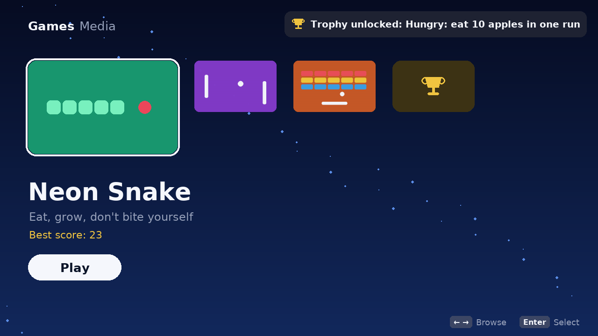
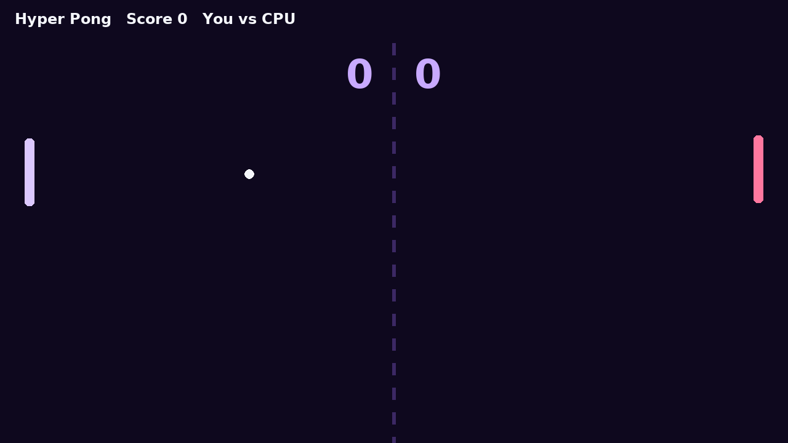
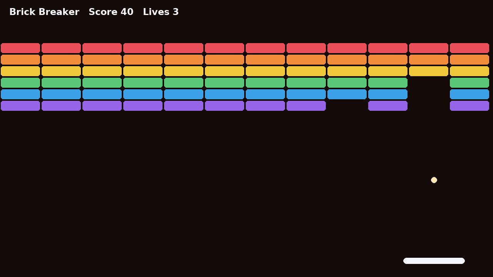

# PyConsole

A PS5-inspired game console interface written in Python with **pygame**: boot animation, a home screen of game tiles, three built-in games, trophies, high scores and gamepad support.




| Hyper Pong | Brick Breaker |
|---|---|
|  |  |

## Features

- **Console home screen:** tiles that grow when focused, smooth scrolling, a clock, a trophy counter and button hints
- **Three games:** Neon Snake, Hyper Pong (vs a CPU) and Brick Breaker
- **Trophies** with pop-up notifications, plus a Platinum trophy for unlocking all the others
- **High scores** saved to `~/.pyconsole/save.json`
- **Pause menu** in every game
- **Keyboard or gamepad:** arrows/WASD, Enter/Space, Esc. Any SDL-compatible controller works (D-pad or left stick, A/✕ to select, B/○ to go back)

## Run it

```bash
pip install -r requirements.txt
python -m pyconsole
```

## How it works

```
pyconsole/
  app.py        Console state machine (boot → home → game / trophies), input mapping, drawing
  ui.py         theme, gradients, particles, button hints, trophy icon
  storage.py    JSON save data (high scores, trophies)
  games/
    base.py     Game interface: press/release actions, update(dt), draw(surface)
    snake.py  pong.py  breakout.py
```

Games never read the keyboard directly. They receive abstract actions (`up`, `down`, `left`, `right`, `confirm`), so the same code works with a keyboard, a gamepad, or an automated test.

## Tests

```bash
pip install -r requirements-dev.txt
SDL_VIDEODRIVER=dummy pytest
```

The tests run the console headlessly. They cover the boot-to-home flow, menu navigation, each game playing until game over, pausing, trophies (including Platinum) and the save file. GitHub Actions runs them on every push.

## Adding a game

1. Create `pyconsole/games/mygame.py` with a class extending `Game`. Implement `update(dt)`, `draw(surface)` and `draw_icon(surface, rect)`, and set `over = True` when the game ends.
2. Add it to `GAMES` in `pyconsole/games/__init__.py`.

It then appears on the home screen with high scores and trophies.

---

*A fan project inspired by modern console interfaces. Not affiliated with or endorsed by Sony Interactive Entertainment.*
